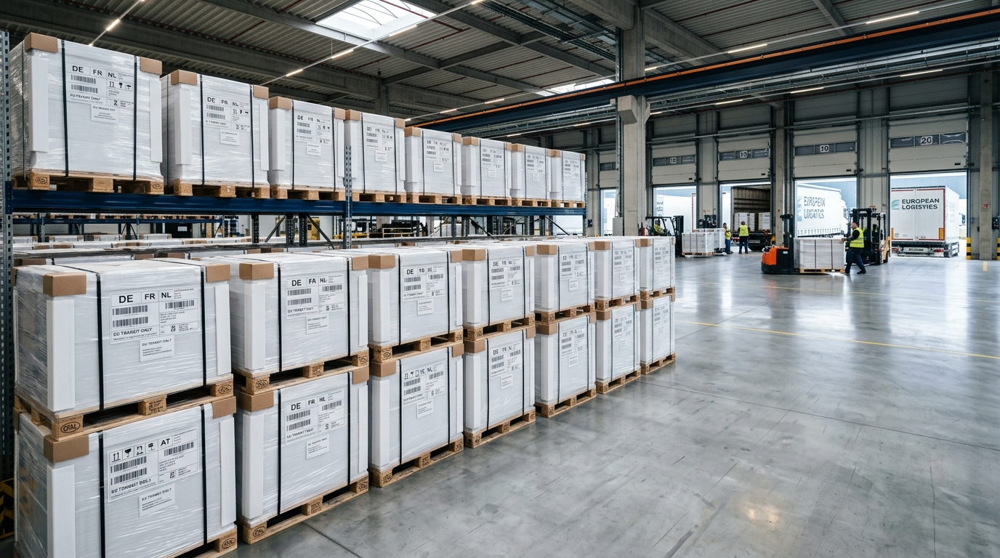

Il trasporto internazionale su gomma richiede cura e precisione fin dalla fase di preparazione del bancale. Un carico preparato a regola d'arte garantisce l'incolumità della merce, ottimizza gli spazi a bordo e accelera le operazioni di scarico negli interporti europei.

In questo approfondimento, i tecnici di **M-SPEED SRL** condividono le migliori pratiche per l'allestimento di merce pallettizzata destinata a **Germania, Francia, Benelux, Spagna e Romania**.

---

## Gli standard di bancale più diffusi in Europa

Prima di confezionare la merce, è fondamentale scegliere la tipologia di supporto corretta:

- **Europallet (EPAL 1):** Dimensioni 800 × 1200 mm. È lo standard più utilizzato nei magazzini e nei centri distributivi di tutta Europa.
- **Pallet Industriale (EPAL 2 / ISO):** Dimensioni 1000 × 1200 mm, ideale per carichi voluminosi o macchinari.
- **Mezzo bancale (EPAL 6 / EPAL 7):** Dimensioni 600 × 800 mm, utilizzato frequentemente per consegne nella grande distribuzione organizzata o punti vendita cittadini.

---

## 4 Regole d'oro per la pallettizzazione

Per garantire la stabilità del carico sui lunghi tragitti autostradali verso il Nord Europa:

1. **Evitare sporgenze laterali:** La merce non deve oltrepassare il perimetro del pallet per evitare sfregamenti tra bancali adiacenti nel semirimorchio.
2. **Distribuzione uniforme del peso:** Posizionare sempre i colli più pesanti alla base e quelli più leggeri in sommità.
3. **Fasciatura adeguata:** Utilizzare film estensibile di grammatura idonea, effettuando almeno 3-4 giri alla base legando il film al pallet di legno.
4. **Protezione degli angoli:** L'applicazione di angolari in cartone pressato previene lo schiacciamento delle scatole causato dalle cinghie di ancoraggio.

---

## Documentazione e marcatura

Ogni pallet deve recare un'etichetta di spedizione chiaramente leggibile con:

- Ragione sociale e indirizzo completo del destinatario
- Numero di colli e peso lordo effettivo
- Riferimento ddt o CMR internazionale

> **Il consiglio dell'esperto:** Nei trasporti verso Germania e Francia, la precisione del peso dichiarato sul CMR evita contestazioni alle pese autostradali e garantisce il rispetto dei limiti dell'asse del camion.

Hai bisogno di una consulenza per spedire la tua merce in sicurezza? Scopri i nostri [servizi di trasporto internazionale](/servizi/) o [contatta direttamente un nostro operatore](/contatti/).
